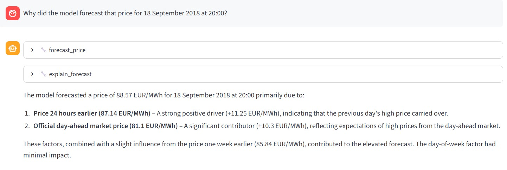
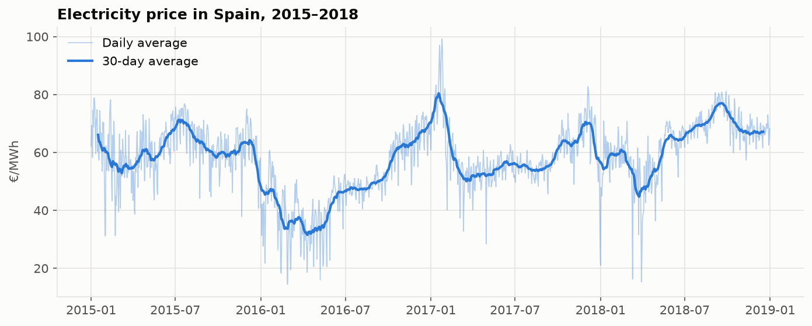
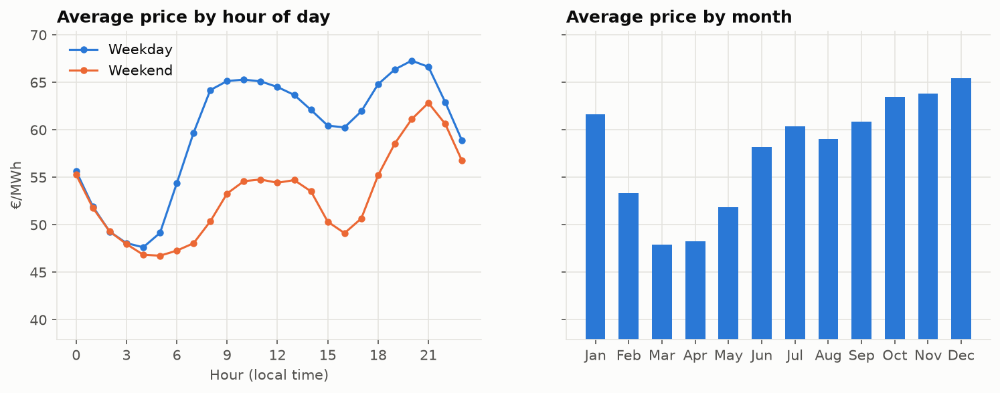
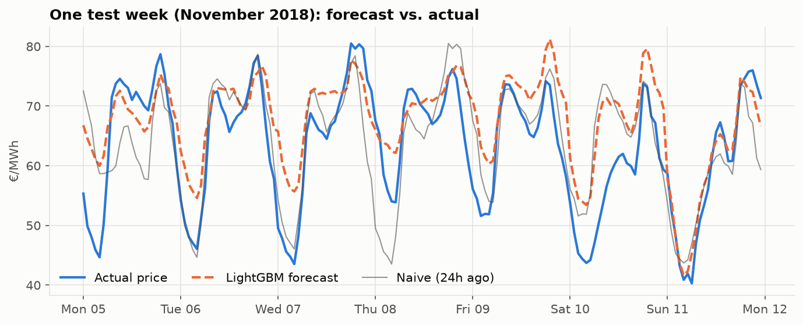
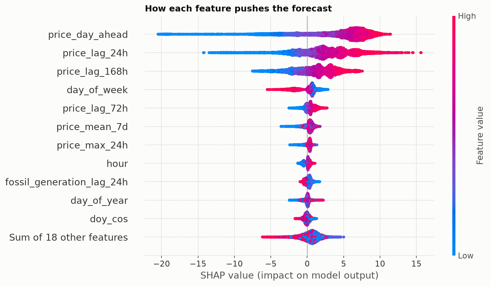
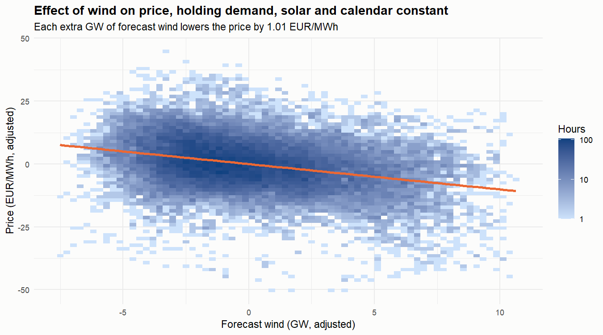
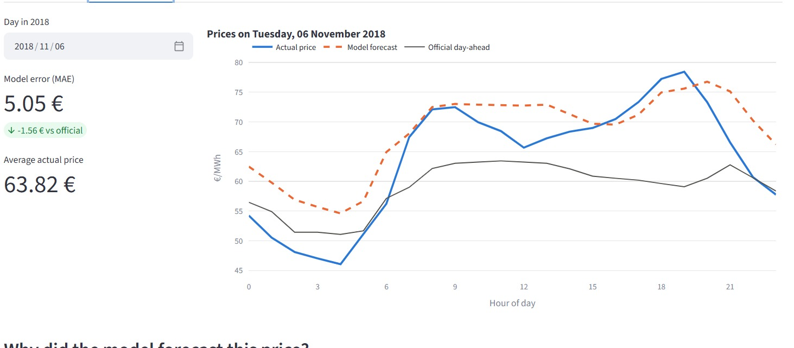
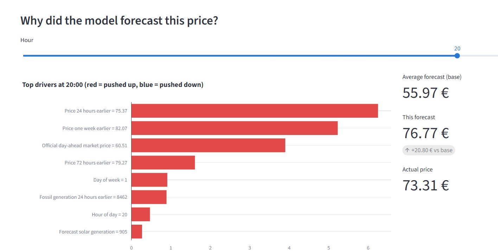

# ⚡ Energy Price Forecasting Agent

Forecasting hourly electricity prices in the Spanish market 24 hours ahead, explaining what drives them, and an LLM analyst agent that answers questions about the market, runs what-if scenarios, and is evaluated for accuracy.



## Highlights

| | |
|---|---|
| **Forecasting** | LightGBM, test MAE **3.80 €/MWh** on the unseen year 2018, **27 % better** than a naive baseline |
| **Explainability** | SHAP explanations for every single forecast, including a documented failure case |
| **Statistics (R)** | Each extra GW of wind lowers the price by **≈ 1 €/MWh** (Newey-West regression) |
| **LLM agent** | Tool-calling agent with SQL, forecast, SHAP and what-if tools; runs locally for free |
| **Evaluation** | **72/72 correct** on 24 test questions × 3 runs, after 5 measured iterations |
| **App** | Streamlit app with agent chat and an interactive forecast explorer |

**Tech:** Python · pandas · LightGBM · scikit-learn · SHAP · R (sandwich, lmtest, ggplot2) · SQLite · LLM tool calling (OpenAI-compatible API, LM Studio, Qwen3-4B) · Streamlit · Plotly

## How it works

```
 Kaggle CSVs ──► cleaning ──► features ──► LightGBM ──► forecasts (2018)
                                              │              │
                                            SHAP          SQLite DB
                                              │              │
                         ┌────────────────────┴──────────────┴─────────────┐
                         │  LLM agent: query_database · forecast_price ·   │
                         │             explain_forecast · run_scenario     │
                         └────────────────────────┬────────────────────────┘
                                                  │
                                           Streamlit app
```

## Dataset

[Hourly energy demand, generation and weather — Spain (2015–2018)](https://www.kaggle.com/datasets/nicholasjhana/energy-consumption-generation-prices-and-weather) from Kaggle.

Download the two CSV files and place them in `data/raw/`:

```
data/raw/energy_dataset.csv
data/raw/weather_features.csv
```

## Exploratory Analysis Highlights

Full analysis: [`notebooks/01_eda.ipynb`](notebooks/01_eda.ipynb)



- **Strong seasonality:** two daily peaks on weekdays (9–12h and 19–21h), cheaper weekends, cheapest in spring.
- **Generation mix matters:** coal, gas and demand push prices up; wind pushes them down.
- **The official forecast is biased:** it has an MAE of **10.5 €/MWh** and underestimates the actual price by ≈ 8 € on average.



## Forecasting Results

Full analysis: [`notebooks/02_modeling.ipynb`](notebooks/02_modeling.ipynb)

**Task:** predict the price 24 hours ahead, using only information available at forecast time. Trained on 2015–2017, tested on the unseen year **2018**.

| Model | MAE (€/MWh) | RMSE (€/MWh) | vs. naive |
|---|---:|---:|---:|
| **LightGBM** | **3.80** | **5.40** | **+27%** |
| Ridge regression | 4.04 | 5.75 | +22% |
| LightGBM (without official forecast) | 4.16 | 5.93 | +20% |
| Naive (same hour yesterday) | 5.21 | 7.70 | baseline |
| Seasonal naive (same hour last week) | 6.39 | 9.64 | −23% |
| Official day-ahead forecast | 8.86 | 11.89 | −70% |

> **Why the naive baseline, not the official forecast?** The official figure is the day-ahead *market* price, which is systematically ≈ 6 € below the final price. A simple "same as yesterday" forecast already beats it, so it is the honest benchmark.



## Explainability (SHAP)

Full analysis: [`notebooks/03_explainability.ipynb`](notebooks/03_explainability.ipynb)

Every forecast is broken down into per-feature contributions, so we can answer *"why does the model expect this price?"*.



- The official day-ahead price and recent prices are the main drivers.
- Weekends lower the forecast; more forecast wind lowers it, higher residual load raises it.
- **Failure case:** on Easter Sunday night 2018 the model followed an extremely low market signal too closely (predicted 13.9 €, actual 32.8 €).

## Statistical Analysis in R

Full analysis: [`r_analysis/`](r_analysis/README.md)

A regression with Newey-West standard errors (to account for autocorrelation) shows that **each extra GW of forecast wind lowers the price by ≈ 1 €/MWh** (95% CI −1.15 to −0.87), holding demand, solar and calendar effects constant. This is the *merit order effect* of renewables.



## LLM Analyst Agent

Code: [`src/agent/`](src/agent/)

An agent that answers natural-language questions about the market by deciding which tool to call:

| Tool | What it does |
|---|---|
| `query_database` | Runs a read-only SQL query over historical data (2015–2018) and the model's 2018 forecasts |
| `forecast_price` | Returns the model's forecast for a specific hour, with the actual and official prices |
| `explain_forecast` | Explains a forecast with its top SHAP drivers |
| `run_scenario` | What-if analysis: re-runs the forecast with more/less wind, solar or demand |

> **Why a second model for scenarios?** The main model relies heavily on the official day-ahead price, which already reflects expected wind and demand. Changing wind while holding that price fixed barely moves its forecast (−0.17 €/MWh per GW). Scenarios therefore use a *fundamentals-only* model (test MAE 4.16), which responds with −0.76 €/MWh per GW, in line with the R regression (−1.01).

The agent runs a tool-calling loop: the LLM requests a tool, Python executes it, the result is sent back, and this repeats until the LLM writes a final answer.

```
You: What was the model's biggest error in 2018 and when did it happen?
  [tool] query_database(SELECT time, abs_error FROM forecasts WHERE year = 2018 ...)   -> error: no such column
  [tool] query_database(SELECT time, abs_error FROM forecasts ORDER BY abs_error DESC LIMIT 1)

Agent: The model's biggest error in 2018 was €34.66/MWh, at 19:00 on March 11, 2018.
```

**Design choices**
- **Runs locally for free** with [LM Studio](https://lmstudio.ai) and `qwen3-4b-instruct-2507` (fits on a 4 GB GPU). Any OpenAI-compatible endpoint works by changing `.env`.
- **Grounded answers:** the system prompt requires every number to come from a tool result.
- **Safe SQL:** only single `SELECT` statements, executed on a read-only connection.
- **Self-correction:** tool errors are returned to the LLM so it can fix its own query (see example above).
- **Bounded:** at most 6 tool-calling steps per question.

### Evaluating the agent

Code: [`src/agent/evaluation.py`](src/agent/evaluation.py)

An LLM app that "seems to work" in a demo is not the same as one that works reliably. The agent is evaluated on **24 questions with known answers** (historical data, model performance, single forecasts, explanations, what-if scenarios, and questions in Turkish). The answer key is computed from the database and the model at run time, so it can never go stale. Each question is asked **3 times**, because LLM answers vary between runs.

Each run checks whether the agent (1) called the right tool and (2) gave the correct number (0.5 % tolerance; counts must match exactly).

| Iteration | Answer accuracy | Failure found | Fix |
|---|---:|---|---|
| 1 | 95 % | Used the *model's* error column when asked about the *official* forecast's error | Added an explicit `official_abs_error` column |
| 2 | 97 % | Matched `time LIKE '2018-03-% 00:00'`, which fails because times include seconds | Added `month`, `day_of_week`, `hour` columns to the forecasts table |
| 3 | 97 % | Filtered `forecasts` by `year`, a column that only existed in the other table | Gave both tables the same calendar columns |
| 4 | 100 % (63/63) | Manual test: refused a Turkish question with a vague word ("harcama" = spending) | Prompt rules: convert dates in any language, state an assumption instead of refusing, do arithmetic in SQL. Added 3 Turkish test questions |
| **5** | **100 %** (72/72) | none | |

Tool choice was 100 % correct in every iteration; average answer time is 4.7 s on a 4 GB laptop GPU.

**Lesson:** every failure came from the *data design*, not the model being "not smart enough". Small models do best when the schema leaves no room for ambiguity, and running each question several times was essential to catch failures that appeared only once in three runs.

```bash
python -m src.agent.evaluation --repeats 3                 # evaluate the default model
python -m src.agent.evaluation --model another-model-name   # compare another model
```

## Project Structure

```
├── data/            # raw and processed data (not tracked by git)
├── notebooks/       # exploratory analysis
├── src/
│   ├── data/        # loading and cleaning
│   ├── features/    # feature engineering
│   ├── models/      # training, evaluation, prediction
│   └── agent/       # LLM agent and tools
├── app/             # Streamlit interface
├── r_analysis/      # statistical analysis in R
├── reports/figures/ # generated plots
└── tests/
```

## Setup

```bash
python -m venv .venv
.venv\Scripts\activate        # Windows
pip install -r requirements.txt

python -m src.data.load          # clean the raw data
jupyter nbconvert --to notebook --execute --inplace notebooks/02_modeling.ipynb   # train and save the model
python -m src.agent.database     # build the SQLite database for the agent
```

To run the agent, start the LM Studio server with `qwen3-4b-instruct-2507` loaded, copy `.env.example` to `.env`, then:

```bash
python -m src.agent.agent             # chat in the terminal
streamlit run app/streamlit_app.py    # or use the web app
```

The web app has two tabs:
- **Ask the analyst:** chat with the agent; every tool call (including the generated SQL and its result) can be expanded.
- **Forecast explorer:** pick any day in 2018 to compare the actual price, the model forecast and the official day-ahead price, then pick an hour to see its SHAP drivers.





## Roadmap

- [x] Data loading, cleaning and EDA
- [x] Baseline and gradient boosting forecasting models
- [x] SHAP explainability and R statistical analysis
- [x] LLM analyst agent with tools
- [x] Streamlit app
- [x] Final results and demo
